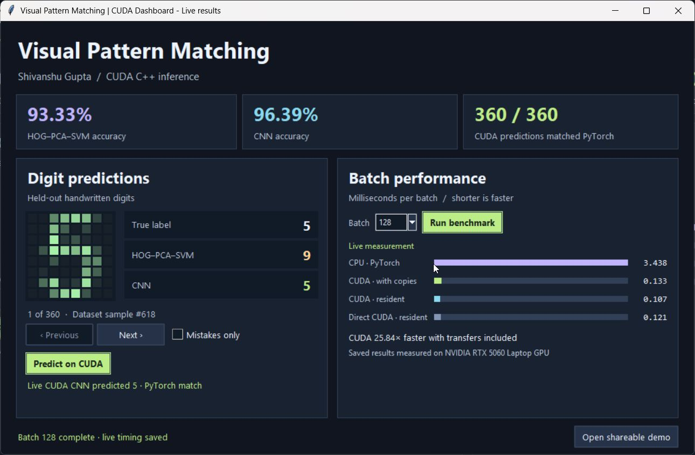
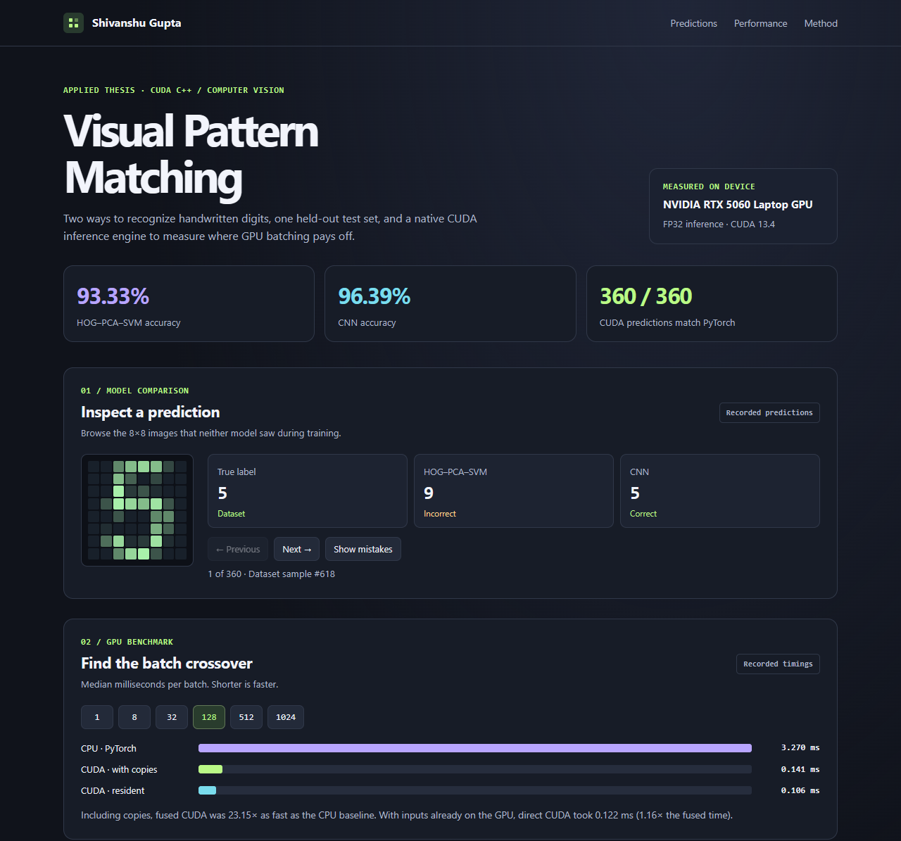

# GPU-Accelerated Visual Pattern Matching

**Shivanshu Gupta · Personal thesis and CUDA project**

A handwritten digit classifier and CUDA C++ inference benchmark. The project compares HOG–PCA–SVM with a trained CNN on the same held-out images, then tests when a custom GPU implementation can overcome launch and transfer costs.

[Try the interactive browser demo](https://sgshiv001.github.io/GPU-Accelerated-Visual-Pattern-Matching./) · [Read the thesis report (PDF)](docs/Thesis-Report.pdf) · [Reproduce the benchmarks](vision/BENCHMARK.md)



*Windows dashboard running native CUDA inference on held-out sample #618. The performance panel shows a separate live benchmark run.*

## Results

Both classifiers use the same [scikit-learn Digits dataset](https://scikit-learn.org/stable/modules/generated/sklearn.datasets.load_digits.html), with 1,437 images for training and 360 for testing. The split is stratified with seed 42. Each grayscale image is 8×8 pixels.

| Held-out evaluation | Correct | Accuracy |
| --- | ---: | ---: |
| HOG–PCA–SVM | 336 / 360 | 93.33% |
| Two-block CNN | 347 / 360 | 96.39% |
| Native CUDA CNN agreement with PyTorch | 360 / 360 | 100% agreement |

The direct and fused CUDA paths reproduced every PyTorch class prediction with a maximum absolute logit difference of **8.58 × 10⁻⁶**. Compute Sanitizer reported zero memory errors and shared memory hazards in the tested workloads. [Evaluation data](vision/results/evaluation.json) · [Validation commands](vision/BENCHMARK.md)

| Images per batch | PyTorch CPU | Direct CUDA, resident | Fused CUDA, resident | Fused CUDA, with transfers |
| ---: | ---: | ---: | ---: | ---: |
| 1 | 0.0570 ms | 0.0864 ms | 0.0543 ms | 0.0649 ms |
| 8 | 0.3155 ms | 0.0472 ms | 0.0311 ms | 0.0686 ms |
| 128 | 3.2704 ms | 0.1223 ms | 0.1055 ms | 0.1413 ms |
| 512 | 12.7377 ms | 0.3985 ms | 0.3706 ms | 0.4534 ms |

At batch 128, fusing the CUDA layers lowered device-resident latency by **13.7%**. Including host and device transfers, the fused path took **0.141 ms** versus **3.270 ms** on single-thread PyTorch. At batch 1, the CPU finished sooner when transfers counted. The table reports median latency per batch on an Intel Core i7-14650HX and NVIDIA GeForce RTX 5060 Laptop GPU using FP32. [Raw timings](vision/results/latency.csv) · [Nsight Systems kernel summary](vision/results/nsys-kernels.csv)

## How it works

| Path | Implementation |
| --- | --- |
| Classical model | Normalize pixels, extract 36 HOG features, apply training-only PCA, and classify with an RBF SVM. PCA selected 27 components and retained 95.22% of the training variance. |
| CNN training | Train in PyTorch for 20 epochs with Adam. Two padded 3×3 convolution, ReLU, and max pooling blocks feed a 128-unit dense layer and a ten-class output. |
| Direct CUDA inference | Run each convolution and its activation/pooling as separate kernels, then run the two dense layers. This produces six kernel launches per forward pass. |
| Fused CUDA inference | Stage inputs in shared memory and use warp shuffles to compute pooling maxima. Each convolution block writes the pooled result directly, reducing the forward pass to four launches. |

The [personal thesis report](docs/Thesis-Report.pdf) presents the research question, model designs, and mathematical derivations. The research figures include simulated CNN results and analytical GPU estimates. The README reports measurements from this implementation. The [implementation notes](vision/README.md#how-this-relates-to-the-thesis) explain the PCA, padding, and convolution choices.

## Try it in the browser

Open the interactive demo to browse all 360 held-out samples, filter for mistakes, and compare recorded batch timings. Switch from batch **1** to **128** to see how transfer costs affect the crossover. The browser displays saved results. The Windows app runs fresh CUDA inference and benchmarks. [Online demo](https://sgshiv001.github.io/GPU-Accelerated-Visual-Pattern-Matching./) · [Download standalone HTML](https://raw.githubusercontent.com/sgshiv001/GPU-Accelerated-Visual-Pattern-Matching./main/vision/demo.html)



## Run the Windows dashboard

Use Windows with Python 3.14 and Tkinter. The dashboard opens with saved results. For live actions, install the Python dependencies and build the DLL with a CUDA-capable NVIDIA GPU, the CUDA Toolkit on PATH, and a supported x64 Visual Studio C++ toolchain. The verified setup used CUDA 13.4 and Visual Studio 2026 Build Tools.

```powershell
git clone https://github.com/sgshiv001/GPU-Accelerated-Visual-Pattern-Matching..git cuda-visual-pattern-matching
cd cuda-visual-pattern-matching
python -m pip install -r vision/requirements.txt
.\build.cmd vision
& '.\Launch Dashboard.cmd'
```

Choose **Predict on CUDA** for the current sample or **Run benchmark** for the selected batch size. The dashboard writes each live run under `build/dashboard-runs/`.

The repository includes the trained weights so you can verify or benchmark immediately after building. To train again, run `python vision/train.py`. To run the benchmark and regenerate the browser demo, use the commands below.

```powershell
python vision/benchmark.py --verify-only
python vision/benchmark.py --predict-id 618
python vision/benchmark.py --batches 1 8 32 128 512 1024
python vision/make_demo.py
```

## Project files

| File or directory | Contents |
| --- | --- |
| [vision/model.py](vision/model.py) and [vision/train.py](vision/train.py) | Preprocessing, classical model, CNN architecture and training |
| [vision/inference.cu](vision/inference.cu) | Direct and fused CUDA kernels, device buffers and timing |
| [vision/dashboard.py](vision/dashboard.py) | Windows dashboard with live inference and benchmarking |
| [vision/results/](vision/results/) | Trained weights, held-out predictions, measurements and profiler summaries |
| [docs/Thesis-Report.pdf](docs/Thesis-Report.pdf) | Personal thesis report with research methods, figures, and references |
| [docs/GEMM.md](docs/GEMM.md) | Companion CUDA matrix multiplication lab with shared-memory and register tiling |
